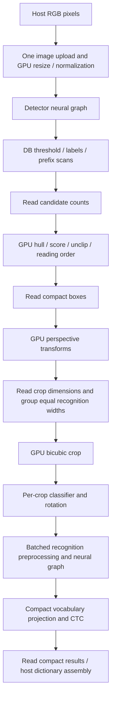

GPU backend analysis, measured locally on 2026-10-24

This is the pre-change baseline. The subsequent implementation and validation
are recorded in [GPU optimization results](gpu-optimization-2026-10-24.md).

The current GPU backend has substantial optimization opportunities, principally
in convolution selection and classifier batching. On this Apple M4, the current
Full GPU path is faster than hybrid GPU execution but slower than SIMD CPU
execution for every measured preset. Moving more work onto the GPU is therefore
not, by itself, the next performance improvement.

This analysis covers commit `84f84b5` without changing production or test code.
Hardware: physical Mac mini, Apple M4 with 10 GPU cores, 16 GiB unified memory,
macOS 27.0.1 (26A434), Metal. Builds use the pinned nightly toolchain, locked
dependencies, wgpu 30.0.1, release optimization, and all features. The separate
unit tests use `--no-default-features --features gpu,profiling` because an
existing ARM64 parallel test does not compile; limitations are recorded below.
The previous AMD/Vulkan results in [gpu-performance-phase.md](gpu-performance-phase.md)
are historical evidence and are not pooled with these measurements.

The evidence is in the ignored local directory
`reports/gpu-analysis-2026-10-24/`: `summary.json`, `model-inventory.json`,
`typical/manifest.json`, `dense/manifest.json`, `concurrency/manifest.json`,
correctness manifests, raw outputs, and test logs. Benchmark manifests include
source/model/dictionary/input/executable hashes and frozen source and executable
copies. `followups.json` records commands, timeouts, and the execution budget.

Two image inputs were used: the repository's 500×500 sample page, with 16
detected lines, and its generated 1000×1000 2×2 repetition, with 64 lines. Detector
inputs are 512×512 and 960×960 respectively. These are not two independent real
documents. Every configuration has one cold invocation and three measured warm
invocations. Stage profiles come from one additional, separately instrumented
call per worker where requested. Capture of CTC alignment is enabled throughout
the OCR comparison. CPU settings are explicitly 4 line workers, 8 detector
threads, and 16 preprocessing workers; recognition batch size is 2. Precision is
FP32. Ordinary rows use one request and one GPU slot.

| Workload | CPU warm ms | Hybrid GPU warm ms | Full GPU warm ms | Full / CPU latency |
|---|---:|---:|---:|---:|
| Tiny, typical | 52.11 | 108.19 | 94.30 | 1.81× |
| Small, typical | 121.47 | 313.46 | 293.56 | 2.42× |
| Medium, typical | 355.56 | 1231.52 | 1206.18 | 3.39× |
| Tiny, dense | 166.14 | Not measured | 304.58 | 1.83× |

All entries are medians, not best runs. Full's typical-page raw samples are
93.92/94.45/94.30 ms, 294.91/288.86/293.56 ms, and
1206.18/1207.25/1198.28 ms. Dense Full samples are 306.12/304.58/302.09 ms.
Full reduces latency relative to hybrid by approximately 12.8%, 6.3%, and 2.1%
on the three typical-page presets. The modest warm ranges support the ordering
on these inputs, but three samples are not a confidence interval or a general
throughput guarantee. Input decoding, owned-result conversion, output checking,
serialization, construction, and profiling are outside the warm timing interval.

The execution path is:

Full execution still requires host scheduling and compact control/output
readbacks. Intermediate images, feature tensors, and dense vocabulary logits
remain on the device. Hybrid uses GPU neural inference but CPU image processing,
geometry, compact projection, and CTC. Strict GPU calls in this experiment
reported GPU placement, no CPU compute stages, and no diagnostic tensor
downloads.

The following table traces each stage and its measured cost. Values are sums of
available GPU timestamps from the separate Full profiles, in milliseconds.
They are not an additive decomposition of uninstrumented latency. Metal reports
pass-level timestamps here; profiling splits neural execution into individual
passes, unlike normal execution. Full profile wall times are 112.01, 322.80,
and 1241.80 ms versus the warm medians above. There are respectively 7, 5, and
10 unavailable timestamp records, all in reading order, transform metadata, or
CTC. Thus those small-stage totals are incomplete; missing values are not zero.
All detector, classifier, recognizer, and projection records are present.

| Stage | Tiny ms | Small ms | Medium ms | Implementation and assessment |
|---|---:|---:|---:|---|
| Image processing | 2.45 | 2.66 | 9.35 | `resident.rs`, `image.wgsl`, `crop*.wgsl`, `rotate.wgsl`: byte-domain resizing, normalization, two-FP32 perspective sampling, and orientation. Lower priority than neural kernels. |
| Detector backbone | 13.08 | 30.31 | 192.06 | `vision::Detector`, physical graph, convolution kernels. Medium has expensive generic 2×2, 5×5, and 7×7 convolutions and a costly tiled 3×3 convolution. |
| DB geometry | 2.46* | 2.37* | 2.32* | `db_label`, `db_rows`, `db_geometry`, `db_sort`: two-level prefix scans already exist. Hull/rectangle/scoring work is serial within each candidate; reading order uses one invocation. Potential for complex documents, but low measured priority here. |
| Orientation classifier | 23.90 | 23.32 | 23.73 | Fixed `[1,3,80,160]` session, called separately for each of 16 crops. Generic convolutions account for about 19.1–19.3 ms. Batching is a strong candidate. |
| Recognizer backbone | 46.26 | 215.92 | 962.38 | Equal-width batches, fused convolutions/SE/layer norm/attention, compact feature output. Highest priority, especially large-channel pointwise convolutions. |
| Vocabulary projection | 8.80 | 23.34 | 35.63 | `heads4.wgsl` reuses each weight across four rows, then `head_reduce.wgsl` combines winners and probability denominators. Includes the classifier's small projection too. Secondary target. |
| CTC | 0.078* | 0.117* | 0.047* | `ctc.wgsl`: blank/repeat handling, spans, byte budgets, and compensated line scores. Incomplete timestamps, but no evidence supporting prioritization over the large neural costs. |
| Host output read/assembly | — | — | — | Profiled mapped-read handling totals only 0.018/0.022/0.025 ms. Dictionary lookup and public-result assembly are not separately timed in Full; do not treat zero CPU stage fields as measured zero work. |

`*` Incomplete timestamp coverage. Image processing is also missing its small
transform-metadata dispatch in these profiles. Its measured sub-costs are
normalization 1.48/1.51/6.86 ms, bicubic sampling 0.92/1.10/2.44 ms, and rotation
about 0.05 ms. These aggregates include preprocessing for all neural stages.

Runtime construction, lowering, memory, and scheduling also matter:

| Link | Existing behavior | Optimization assessment |
|---|---|---|
| Model compilation | Validates a shared logical graph, uploads immutable weights per context/precision, and shares pipelines and projection heads. GPU compilation does not construct a CPU plan. | Preserve plan/context reuse. `Pipelines::shared` eagerly compiles 27 FP32 shader kinds; selective compilation is a startup candidate. No controlled driver-cache experiment was performed. |
| Physical lowering | Fuses convolution epilogues, SE and layer norm; folds private attention Q/K/V views; aliases eligible reshapes and places compatible concat producers directly into destinations. | Much basic fusion work is already implemented. Additional fusion should target measured dispatches, not repeat existing transformations. |
| Kernel selection | Portable generic kernels plus tiled 16/32 convolution/matmul, specialized depthwise, online attention, and restricted NHWC paths. Selection uses shapes and enabled features. | Important gaps are the fixed minimum tile-group threshold, large-channel pointwise handling, and generic non-1×1/non-3×3 dense convolutions. |
| Precision | Full DET/REC explicitly retain FP32 even in a mixed context to preserve boxes and CTC spans; classifier may use mixed storage. | Enabling mixed mode is not a general DET/REC speed switch. FP16 changes need semantic qualification; prior tensor-only checks did not ensure OCR parity. |
| Memory | Liveness-based activation reuse, cached shape schedules, bounded reservations, and at most two pending recognition waves. Resident scratch caching defaults off. | Typical Full retains 35.74/80.06/232.52 MiB and peaks at 40.75/90.17/246.17 MiB before profiling. Tiny dense retains 100.04 MiB, peak 117.82 MiB. These are application buffer accounts, not total GPU memory. |
| Transfer boundary | One source upload; compact candidate metadata, boxes, dimensions, and token results are downloaded. | Typical uploads 750,000 bytes and downloads 28,144/26,896/29,584 output-plus-control bytes. Dense uploads 3,000,000 and downloads 110,032 bytes. These payload counters are not physical bus traffic counters. Transfer volume is already small. |
| Host encoding | Neural graph bindings are reused where possible. Each resident dispatch still creates a 1 KiB parameter buffer and a bind group and formats shader source before the kernel-cache lookup. | Parameter arenas, cached source strings, and bounded readback/scratch reuse are reasonable later experiments. Typical scratch allocations are 127 per call; dense 395. They do not include all parameter/bind-group allocations. |
| Synchronization | Three initial submission/readback boundaries, then width-group recognition waves. One admission guard covers recognition; at most two waves remain pending. | Typical has 16 submissions and dense 35. The pipeline already overlaps encoding with submitted work; further queue-depth gains are modest in this measurement. |
| Shape cache | Eight previous plans plus the current plan, with generation-sensitive bindings. | The typical page visits 13 distinct `(batch,width)` shapes per request with one slot. A repeated ordered traversal exceeds cache capacity and implies schedule-cache churn. Confirm with dedicated miss/reshape counters before changing capacity; retain memory bounds. |

The measured normal dispatch counts are 1,590/2,500/2,588 for typical
tiny/small/medium, and 4,807 for tiny dense. Recorded layout-conversion counts
are zero for these FP32 Full runs. There is no measured basis for globally
enabling FP32 NHWC conversion. Profiled host encoding is 2.42/2.94/3.21 ms;
profiled queue submission is 24.34/40.02/42.88 ms. The latter includes the cost
of the many extra measured passes and timestamp operations, so it must not be
presented as normal production overhead. Completion wait overlaps queued GPU
work and is not another independent cost to add to device durations.

The strongest optimization targets, in implementation order, are:

1. Batch the orientation classifier and revisit small-matrix selection. The
   classifier currently stays at batch 1 even when recognition batch size is 2.
   `operators::specialize` rejects tiled kernels below 128 groups of 16×16.
   A 64→64 pointwise layer at 5×80 has 100 such groups; a 128→128 layer at
   3×80 has 120. Both therefore use `conv_generic`. Batch 2 crosses the guard.
   An isolated full-classifier test confirmed the mechanism: generic steps drop
   from 18 to 5, while tiled pointwise variants replace them.

   | Classifier tensor | Median device ms per call | Device ms per crop | Instrumented wall ms |
   |---|---:|---:|---:|
   | `[1,3,80,160]` | 2.762 | 2.762 | 3.581 |
   | `[2,3,80,160]` | 1.964 | 0.982 | 2.685 |

   Each has one correctness warmup and three measured calls. Both match the CPU
   at the existing FP32 gate; maximum absolute error is `7.75e-7`. Batch 2 gives
   about 2.81× device throughput per crop in this isolated test, which includes
   the full classifier output and differs from the resident feature-prefix
   contract. It is evidence for a batching experiment, not an achieved end-to-end
   speedup. Tiny dense spends 91.20 ms in classifier device work, strengthening
   its priority. Batched preprocessing, per-image rotation decisions, output
   order, and pending resource lifetimes must remain correct.

2. Optimize large-channel FP32 recognition pointwise convolutions. Medium's
   `conv_implicit32` recognizer dispatches total 728.35 ms of the 962.38 ms
   recognizer profile. Original ONNX nodes 300/317 expand 768→1536 channels,
   and nodes 309/326 reduce 1536→768; these four 1×1 layers alone total
   171.08 ms across the page's recognition batches. Their spatial height is 3.
   The direct NCHW specialization in `physical.rs` currently requires input
   channels ≤256. Larger reductions retain the general implicit tiled loader,
   including spatial indexing and bounds logic. Investigate reduction tile
   size, register tiling, loads, and occupancy on actual shapes such as
   `[1,1536,3,240]→768`. Do not just remove the channel guard: the historical
   AMD candidate experiment did not show a large-channel benefit, and the
   current Metal candidate benchmark failed before producing usable samples.

3. Add measured specializations for dense 2×2 convolutions, then consider 5×5
   and 7×7 detector layers. Small-recognizer original nodes 4 and 8 are 2×2
   SAME_UPPER convolutions and total 29.23 ms. Medium detector nodes 2 and 4,
   also 2×2, total 32.46 ms; nodes 246 and 251, dense 7×7 and 5×5, total
   24.64 ms. The current tiled convolution selector only handles 1×1 or 3×3
   ungrouped cases. A loader specialized for these known geometries can avoid
   the scalar generic output loop. Preserve asymmetric padding and fused
   epilogues and require a whole-stage improvement after kernel validation.

4. Tune queue depth, then bounded allocation and schedule reuse. Tiny Full
   improved from 94.30 to 87.38 ms with one request and two GPU slots, about
   7.3%. This is useful but much smaller than the CPU/GPU gap. With two requests,
   two slots completed the group in 168.49 ms (11.87 images/s), versus 187.48 ms
   with one slot (10.67 images/s). Two requests share one queue/device; slots do
   not guarantee simultaneous hardware execution. These additional
   configurations address scheduling specifically, rather than expanding the
   original baseline into an unbounded sweep.

   | Requests / slots, tiny typical | Three warm group samples, ms | Median group ms |
   |---|---|---:|
   | 1 / 1 | 93.92, 94.45, 94.30 | 94.30 |
   | 1 / 2 | 87.89, 87.36, 87.38 | 87.38 |
   | 2 / 1 | 187.49, 187.40, 187.48 | 187.48 |
   | 2 / 2 | 168.49, 169.04, 166.18 | 168.49 |

5. Optimize vocabulary projection after the neural kernels. Four-row projection
   costs 6.27/20.02/32.21 ms for the typical presets. Candidate directions are
   more feature/weight reuse or feature-dimension tiling while retaining stable
   full-vocabulary probabilities and lowest-index ties. CTC, host text assembly,
   and DB prefix scans are not the current high-value targets. In dense geometry,
   phases 5 and 9 of the already-optimized prefix scan total only 0.046 ms;
   the entire measured geometry stage is 4.54 ms. Attention and general
   reductions also rank below convolution in these profiles.

For scale only, recognizer work is about 48%, 72%, and 79% of known device time
for tiny/small/medium. If it could be halved with every other cost unchanged,
the corresponding device-work speedup would be approximately 1.31×/1.57×/1.65×.
This is an Amdahl-style scenario using instrumented data, not a wall-latency
prediction or a claim that a proposed kernel will achieve 2×. Even this scenario
does not establish that GPU will beat the current CPU path on M4.

Cold behavior needs a separate controlled experiment. Full construction took
28.19/102.15/96.66 ms and first inference 368.67/319.42/1221.49 ms for the
typical presets. The first hybrid process constructed in 567.90 ms. Correctness
checks had already compiled shaders before these runs, and driver cache state
was not reset. These values describe process/request cold starts in this
session, not first-install latency. Reusing `OcrPlan`, its context, and request
storage is already supported and avoids paying construction for every image.

Validation and measurement limits are material:

- Four CPU-versus-Full image/preset comparisons passed: all three presets on
  typical, and tiny on dense. Text, orientation, count, reading order, scores,
  recognition widths/time steps, and CTC alignment passed the existing gates;
  maximum coordinate difference was 0 pixels. All 14 OCR benchmark
  configurations passed the CPU-output qualification and repeated-output
  checks. Profiled calls also matched their unprofiled output.
- Nine of ten focused resident GPU tests passed, including byte-domain
  preprocessing, perspective crop bytes, DB geometry, reading-order ties,
  projection/CTC, allocation ownership, and fallback behavior. The remaining
  timestamp-page test failed because aggregate `compute_ns()` was unavailable.
  It had already checked its profiled output before the timing assertion.
- The isolated pointwise-candidate test passed its first correctness warmup but
  failed on the first measured aggregate timestamp (`Option::unwrap()` at
  `src/runtime/gpu/tests.rs:2226`). It produced no usable candidate comparison.
  Missing timestamps need investigation before using this harness for kernel
  selection on Metal. Existing valid stage timings and uninstrumented OCR
  latencies remain separately reported; failed experiments are not passes.
- The all-feature test target does not compile on this ARM64 machine:
  `src/ocr.rs:3159`, `3160`, and `3165` refer to `request.cpu`/`cpu_options`
  after those fields moved into `request.plan`. The release examples compile.
  The focused GPU tests compile with the parallel feature disabled. The full
  regression suite was not validated.
- `gpu_shader_check` compiled 18 resident shader/precision variants and passed
  static cooperative-shader validation, then failed parsing its rounding-test
  WGSL: a Rust `#[allow(...)]` attribute appears inside the shader string at
  `examples/gpu_shader_check.rs:128`. Its eight rounding cases did not run.
- Performance execution totaled approximately 29.55 seconds, including the
  failed candidate attempt and classifier probes, excluding builds and separate
  correctness checks. No unchanged configuration was rerun for better numbers.
  No CI, remote runner, VM, production-kernel change, or precision relaxation
  was used. Mixed precision, independent real documents, other GPUs, and broader
  concurrency/batch sweeps were not measured in this analysis.

For this machine and these workloads, use the current CPU path when latency is
the deciding factor. If pursuing GPU improvements, first repair the validation
harness issues, then prototype classifier batching and the identified
convolution specializations. Require preserved OCR semantics and an
uninstrumented end-to-end gain before changing defaults. The existing GPU
residency, compact outputs, graph fusion, and bounded wave scheduling provide
a useful foundation; the measured opportunity is principally in how the neural
work is executed.
