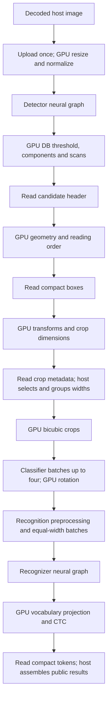

GPU backend evaluation at `f902d85` — 2026-10-24

There is room to improve GPU recognition speed, concentrated in recognition
convolutions. Fresh local measurements of the current implementation put Full
GPU OCR at **66.93 / 191.57 / 617.22 ms** for Tiny / Small / Medium on the
typical page. The SIMD CPU takes **55.94 / 123.08 / 356.74 ms**. GPU residency
is working, but CPU remains the lower-latency choice on this Apple M4 and these
workloads. Increasing recognition batch size from two to eight reduces dense
Tiny GPU latency by **9.0%**, with unchanged OCR outputs under the existing gates.

This evaluates the committed recognition optimization, including packed shared
pointwise weights, H1/H12 selection, tiled RGB stems, and the Logit projection
fast path. Those improvements already exist; the recommendations below concern
remaining work. Production code, model files and defaults were unchanged.
Earlier reports describe different revisions and their samples are kept separate.

All checks ran locally on the physical Mac mini: Apple M4, ten GPU cores,
16 GiB unified memory, macOS 27, Metal, wgpu 30.0.1 and pinned
nightly-2026-09-08. Builds used `--release --locked --all-features`. Benchmark
settings were FP32, one request, one GPU slot, recognition batch two unless
specified, span capture enabled, and default Logit scores. CPU settings were
four line workers, eight detector threads and sixteen preprocessing workers.
Optional subgroup, cooperative-matrix and scratch caching settings were off.

The typical fixture is the repository's 500×500 sample, with sixteen lines.
Dense is a deterministic 1000×1000 repetition, with sixty-four lines. Detector
inputs are 512×512 and 960×960. A rotated fixture was used only for correctness.
These three related inputs do not represent a diverse document corpus.

| Workload | CPU median ms | Full GPU median ms | GPU / CPU latency | GPU warm samples ms |
|---|---:|---:|---:|---|
| Tiny, typical, batch 2 | 55.936 | 66.934 | 1.20× | 67.740, 66.934, 66.434 |
| Small, typical, batch 2 | 123.077 | 191.568 | 1.56× | 191.568, 195.628, 189.781 |
| Medium, typical, batch 2 | 356.740 | 617.220 | 1.73× | 617.220, 619.022, 615.494 |
| Tiny, dense, batch 2 | 172.378 | 218.603 | 1.27× | 219.809, 213.333, 218.603 |
| Tiny, dense, batch 8 | 175.692 | 198.950 | 1.13× | 198.202, 198.950, 201.875 |

CPU warm samples were 50.345/56.100/55.936 ms for typical Tiny,
121.355/123.077/123.403 ms for Small, 356.740/356.527/359.862 ms for Medium,
172.069/173.654/172.378 ms for dense batch two, and
172.520/179.066/175.692 ms for dense batch eight. In particular, Tiny CPU's
5.75 ms range limits precision of the CPU/GPU ratio. No configuration was
rerun to obtain cleaner numbers.

Tiny InferenceOnly GPU takes 101.307 ms, with warm samples
100.004/101.307/102.972 ms. Full GPU is **33.9% faster** on the same page.
This changes image processing, residency, heads and classification scheduling
together; it does not isolate the cost of transfers.

Each of eleven configurations used one cold correctness/warm-up invocation,
three ordinary latency measurements, and one separate diagnostic profile.
The extra profile answers the stage-attribution question; it is excluded from
latency samples. Total benchmark execution, including harness work, startup,
warm-ups and profiles, was **15.05 seconds**, within a single declared
59-second budget. The measured interval includes worker launch through inference
return; it excludes decoding, construction, owned-result conversion, validation,
serialization and the separate profile. Builds and prior correctness checks
are excluded from the performance budget.

The production execution path has three initial host synchronization boundaries
before recognition waves:



The following table sums available device timestamps from one separate Full
profile per configuration. It ranks instrumented work; it does not decompose
ordinary warm wall latency. Profiling splits neural dispatches into individual
passes on this backend, whereas normal execution can group them
([gpu.rs](../src/runtime/gpu.rs), lines 1970–2018). This distinction also follows
the pinned [wgpu timestamp feature contract](https://docs.rs/wgpu/30.0.1/wgpu/struct.Features.html#associatedconstant.TIMESTAMP_QUERY_INSIDE_PASSES):
Metal on Apple GPUs supports pass timestamps but not timestamps inside passes.

| Device stage, ms | Tiny typical | Small typical | Medium typical | Tiny dense b2 | Tiny dense b8 |
|---|---:|---:|---:|---:|---:|
| Image normalization, crop and rotation | 1.595* | 5.497* | 13.142* | 5.971 | 6.571 |
| Detector neural graph | 11.206 | 26.822 | 121.753 | 34.901 | 34.369 |
| DB components, geometry and reading order | 2.446* | 2.371* | 2.307* | 4.618* | 4.582* |
| Orientation classifier graph | 6.033 | 7.327 | 6.091 | 24.520 | 24.206 |
| Recognizer neural graph | 37.286 | 141.280 | 454.463 | 121.620 | 106.515 |
| Vocabulary and classifier projection | 6.171 | 22.518 | 34.108 | 23.997 | 21.876 |
| CTC | 0.073* | 0.353* | 0.797* | 0.091* | 0.075* |

`*` Incomplete timestamp coverage. Missing records total 9/5/5/25/13,
respectively, and occur in geometry, crop metadata or CTC. All neural and
projection records are present. Missing durations are omitted rather than
treated as measured zero. Profile wall times for typical Tiny/Small/Medium
are 76.90/224.30/639.41 ms. Single profiles, particularly small image/CTC
durations, are insufficient for precise comparisons between presets.

The source review covers each link below. References identify current files;
the fresh raw profiles support the numerical priorities.

| Link or stage | Current behavior and optimization assessment |
|---|---|
| Import and model compilation | [compiler.rs](../src/runtime/compiler.rs), [graph.rs](../src/runtime/graph.rs), [gpu.rs](../src/runtime/gpu.rs): common validated logical graphs, shared immutable model weights, context/precision-specific GPU compilation. Reuse plans, contexts and requests. Weight upload is startup work, not repeated for every text line. |
| Shader pipelines | [pipelines.rs](../src/runtime/gpu/pipelines.rs), lines 12–25: context cache eagerly builds the portable FP32 foundation; additional signatures are lazy. Lazy creation of unused foundation pipelines is a startup candidate. No warm-latency gain has been established. |
| Lowering, fusion and storage | [physical.rs](../src/runtime/gpu/physical.rs), [fusions.rs](../src/runtime/gpu/fusions.rs), [storage.rs](../src/runtime/gpu/storage.rs): fused convolution epilogues, channel gates, SE, attention/layer norm, reshape aliases, concat placement and liveness reuse already exist. Full FP32 measurements have zero layout conversions. Further fusion should target measured materialized tensors or dispatches. |
| Source upload | [resident.rs](../src/runtime/gpu/resident.rs), lines 132–149: one source upload after an aligned host copy, with arbitrary supported strides/formats. Reusing upload storage can reduce allocations. Byte counters alone do not establish a unified-memory bandwidth bottleneck. |
| Detector preprocessing | [resident.rs](../src/runtime/gpu/resident.rs), [image.wgsl](../src/runtime/gpu/image.wgsl): byte-domain resize, channel mapping, padding and normalization write directly into resident tensors. Fusion is already present; preserve integer resize and byte rounding. It ranks below neural convolution on the tested pages. |
| Detector inference | [vision.rs](../src/runtime/gpu/vision.rs), lines 24–65, and convolution shaders: resident F32 graph with shape-selected tiled, direct, depthwise and transposed kernels. Medium costs 121.75 ms; selected 3×3 and remaining generic depthwise layers merit focused work. Existing 2×2, 5×5/7×7 and RGB tiling should not be proposed as missing features. |
| DB labeling and scans | [vision.rs](../src/runtime/gpu/vision.rs), lines 337–409, [db_label.wgsl](../src/runtime/gpu/db_label.wgsl): threshold/dilation, tiled components and hierarchical prefix scans execute on GPU. The candidate header creates one host boundary. Combined geometry is about 2.3–4.6 ms here; a broad scan rewrite is low priority. |
| Geometry and reading order | [db_geometry.wgsl](../src/runtime/gpu/db_geometry.wgsl), [db_sort.wgsl](../src/runtime/gpu/db_sort.wgsl): candidate hull/rectangle/scoring includes serial work within each candidate; ordering uses one invocation. Many complex contours may behave differently, but these fixtures do not demonstrate a major bottleneck. Canonical ordering and geometry must survive parallelization. |
| Perspective transform and crop | [vision.rs](../src/runtime/gpu/vision.rs), lines 135–200, [crop_meta.wgsl](../src/runtime/gpu/crop_meta.wgsl), [crop.wgsl](../src/runtime/gpu/crop.wgsl): GPU computes precise transforms and dimensions; host validates/groups shapes, then GPU creates bicubic crop bytes. Combining box and transform-metadata submissions could remove one wait. Savings are unmeasured; retain crop rounding, vertical rotation and validation semantics. |
| Classification and rotation | [ocr/gpu.rs](../src/ocr/gpu.rs), lines 288–344, [heads.rs](../src/runtime/gpu/heads.rs): classification already groups up to four adjacent crops independently of recognition width. Its graph costs about 6–7 ms on typical and 24 ms on dense. Larger batches or rotation/preprocessing fusion are secondary candidates; preserve per-row decisions, tails and bounded pending lifetimes. |
| Recognition width selection and preprocessing | [ocr/gpu.rs](../src/ocr/gpu.rs), lines 222–258, [heads.rs](../src/runtime/gpu/heads.rs), lines 450–495: host sorts exact tensor widths and forms bounded batches; each GPU crop is normalized into the resident batch tensor. Batch eight helps repeated widths in dense documents. Combining different widths needs separate numerical/CTC qualification because added padding changes the model input and time steps. |
| Recognition backbone | [operators.rs](../src/runtime/gpu/operators.rs), lines 784–919, [physical.rs](../src/runtime/gpu/physical.rs), lines 336–382, [pointwise_blocked.wgsl](../src/runtime/gpu/pointwise_blocked.wgsl): main target. It consumes 57.5%/68.5%/71.8% of available typical device time. Packed shared weights and narrow-map/RGB selections are already implemented; global weight layout, operand reuse, remaining small shapes and selected spatial layers are the next candidates. |
| Attention, reductions and layout | Existing online attention, layer norm, SE and reduction fusions retain resident values. Small/Medium attention costs 2.31/2.81 ms and layer norm 0.36/0.40 ms. These rank below convolution. Whole-graph layout conversion or attention replacement needs a specific measured benefit. |
| Vocabulary projection | [heads.rs](../src/runtime/gpu/heads.rs), lines 112–185, [heads4.wgsl](../src/runtime/gpu/heads4.wgsl), [head_reduce.wgsl](../src/runtime/gpu/head_reduce.wgsl): eligible FP32 heads reuse weights across four rows, then reduce partial winners. Logit already skips probability summation; Probability retains a stable full-vocabulary denominator. Tiling the feature dimension or increasing reuse is a second-tier candidate. Preserve ties, scores, invalid-value propagation and row/class tails. |
| CTC, readback and assembly | [ctc.wgsl](../src/runtime/gpu/ctc.wgsl), [heads.rs](../src/runtime/gpu/heads.rs), [ocr/gpu.rs](../src/ocr/gpu.rs): GPU handles blank/repeat/span compaction and byte-budget checks; host maps dictionary strings and restores reading order. Known CTC time is small, with incomplete coverage. Host mapped-read processing is 0.013/0.015/0.019 ms in typical profiles; it excludes completion wait and does not separately measure all text assembly. |
| Encoding and queue scheduling | [resident.rs](../src/runtime/gpu/resident.rs), lines 552–657, [ocr/gpu.rs](../src/ocr/gpu.rs), lines 301–410: each resident dispatch creates a 1 KiB parameter buffer and a bind group; each wave is submitted before reusing session parameters, with at most two waves pending. A parameter arena, cached generated shader strings or fewer resident passes are plausible secondary improvements. Pending ownership and uniform lifetimes constrain reuse. |
| Shape cache and scratch | [gpu.rs](../src/runtime/gpu.rs), lines 39 and 1545 onward: eight previous schedules plus current, with generation-sensitive bindings; [resident.rs](../src/runtime/gpu/resident.rs) offers bounded optional scratch caching. Typical warm recognizer invocations have zero cache hits and thirteen misses, while detector/classifier each have one hit. Cache churn is confirmed, but its wall-time contribution is not isolated. Scratch reuse also requires clearing; allocation counts are not a speedup measurement. |
| Precision and fallback | [vision.rs](../src/runtime/gpu/vision.rs), line 24, [heads.rs](../src/runtime/gpu/heads.rs), line 395: Full DET/REC deliberately use F32 even when mixed precision is requested. Earlier qualification found discrete box/CTC changes with half storage. All fresh Full runs retain GPU placement with no fallback. FP16 or experimental matrix paths need separate whole-OCR qualification and capability checks; they are not established speed switches. |

The strongest remaining kernel evidence is recognition pointwise work. It totals
**21.44 / 76.67 / 338.63 ms** for typical Tiny / Small / Medium: about
33.1% / 37.2% / 53.5% of known device time. Medium's `pointwise_blocked32`
alone costs 289.72 ms. Its current kernel uses a 32×32 output tile, K=16,
64 threads, four-by-four register accumulation, packed shared vectors and two
barriers per reduction tile. Global weights still use the original OI layout.
Packing immutable weights for the cooperative load, or testing a small number
of tile/register variants on actual hot shapes, is a concrete next experiment.
The profiles do not distinguish bandwidth, arithmetic throughput or occupancy;
none of those mechanisms is established without hardware-counter evidence.

| Remaining target | Fresh measured cost | Concrete experiment |
|---|---:|---|
| Medium REC original nodes 300/309/317/326, H=3 pointwise expansion/reduction | 65.95 ms across all recognition units | Use `[1,1536,3,240]→768` and corresponding expansion shapes to test load organization and immutable weight packing. Preserve accumulation/epilogue behavior and account for packed-weight memory. |
| Medium REC H=6, 512/1024-channel pointwise layers | Several individual nodes about 14–15 ms across the page | Extend testing beyond the H=3 case so a tile improvement does not regress the other dominant geometry. The existing H=12 512→256 specialization is already present. |
| Small REC node 19, implicit16 spatial convolution | 9.92 ms, plus 1.39 ms in smaller generic shapes | Test a loader/tile suited to its stride and narrow feature maps; validate asymmetric padding and tails. |
| Small REC generic nodes 305/309, 384→120 pointwise | 2.66 / 2.52 ms | An output `[1,120,1,104]` has only 56 tile16 groups, below the current H1 minimum of 64. Test a targeted lower-occupancy direct kernel. Current H1 fast paths also require at least 128 input channels, 64 output channels and width 64; globally lowering guards is not justified. |
| Medium REC generic nodes 332/336 | 3.69 / 3.60 ms | An output `[1,192,1,80]` has 60 tile16 groups and similarly misses the H1 threshold. Include these shapes when testing the small-matrix policy. |
| Remaining generic REC work, Tiny/Small/Medium | 6.00 / 12.29 / 20.89 ms | Separate H1 tails from channel-gate 1×1 outputs and other small shapes; use a dedicated small-shape policy rather than one global threshold. |
| Medium DET node 268, output `[1,64,128,128]` | 11.63 ms | It already uses implicit32. Test further spatial-input reuse on this 3×3 layer; merely selecting tile32 is no longer a new optimization. |
| Medium DET node 172, generic output `[1,256,128,128]` | 6.48 ms | Qualify a dedicated 9×9 depthwise path. Current depthwise specializations cover 3×3 and 5×5. Lower priority than recognition pointwise. |
| Four-row recognition projection | 5.27 / 20.73 / 32.28 ms | Test feature-dimension tiling/reuse while retaining exact winner ties, Logit/Probability contracts, tails and CTC errors. |

Node numbers are zero-based original ONNX indices from profile lineage;
fused groups include additional nodes. Node costs above sum repeated shapes
and invocations within one page profile, not one isolated dispatch. Earlier
experiments in the [recognition optimization report](gpu-recognition-optimization-2026-10-24.md)
rejected full-K unrolling, and preceding reports rejected some larger-K/layout
variants. Those results discourage repeating the same change without a new
shape or hardware rationale; they do not rule out all future variants.

For scale, halving all recognition pointwise time with other known device
work unchanged would yield approximately **1.20× / 1.23× / 1.37×** speedup in
the available device-time sum. This is an Amdahl scenario, not a wall-time
prediction or evidence that a 2× pointwise speedup is attainable. It also does
not establish that GPU would beat the CPU.

The batch experiment is the immediate measured configuration improvement.
Dense has fifteen distinct widths: batch two produces thirty-two recognition
units, while batch eight produces fifteen. GPU submissions drop from 35 to 18,
dispatches from 2,855 to 1,869, and scratch allocations from 299 to 231.
Recognizer profile time drops from 121.62 to 106.52 ms. Typical has thirteen
distinct widths and already thirteen units at batch two, so a larger upper
bound alone would not combine more of its recognition work. No universal batch
default change is justified by the dense repetition fixture.

| Full configuration | Upload bytes | Output + control bytes | Retained / peak MiB |
|---|---:|---:|---:|
| Tiny typical b2 | 750,000 | 28,144 | 36.86 / 41.87 |
| Small typical b2 | 750,000 | 26,896 | 81.19 / 91.35 |
| Medium typical b2 | 750,000 | 29,584 | 233.64 / 247.29 |
| Tiny dense b2 | 3,000,000 | 110,032 | 101.16 / 118.95 |
| Tiny dense b8 | 3,000,000 | 110,032 | 108.90 / 126.68 |

Batch eight increases both retained and peak accounted allocation by 7.73 MiB.
All measured Full calls have zero CPU compute stages, diagnostic tensor
downloads and layout conversions, and their typed stage reports have no
fallback. Full-vocabulary logits and intermediate images/features remain on
GPU. InferenceOnly uploads 10,598,400 bytes and reads 1,477,376 bytes for Tiny
typical, with thirty reported submissions; its pipeline dispatch field omits
neural dispatches and must not be interpreted as zero GPU work. Counters omit
immutable model upload and small uniforms, exclude opaque driver allocations,
and do not measure physical memory-bus traffic.

Typical instrumented calls record 1.89/2.36/2.55 ms host encoding and
16.28/31.96/36.16 ms submission. These timings include the heavily instrumented
execution behavior; they cannot be subtracted from ordinary latency to infer
host overhead. Completion wait overlaps device execution and cannot be added
as an independent optimization opportunity. The small compact readback volume
and convolution dominance provide little support for prioritizing transfer
payload reduction next.

Observed Full construction took 35.74/46.60/93.73 ms, with first inference
153.96/214.70/662.24 ms for typical Tiny/Small/Medium. Driver caches were not
reset and prior correctness checks compiled shaders. These are process/request
cold observations, not controlled first-install measurements. Persistent
plan/context/request reuse is already supported.

The recommended order is:

1. Use CPU for lowest latency on the measured M4 workloads. For GPU deployments,
   try `.recognition_batch_size(8)` on the application's dense-document corpus,
   accepting the measured memory tradeoff only where useful.
2. Optimize recognition pointwise operand reuse and remaining small-shape
   selection, with selected Small spatial and Medium detector kernels next.
3. Improve projection reuse; then investigate metadata synchronization,
   parameter-buffer arenas and bounded shape/scratch reuse if focused timings
   show meaningful host overhead.
4. Keep CTC, general scan rewrites, additional classifier batching, global layout
   changes and reduced precision behind measured evidence. They currently offer
   less certain benefit or require broader numerical/semantic qualification.

Focused correctness preceded benchmarking. Two physical Metal tests passed:
`gpu_hardware_recognition_pointwise_policy_preserves_boundaries` and
`gpu_projection_score_modes_preserve_contract`. Five fresh CPU-versus-Full OCR
comparisons passed: all three presets on typical, plus Tiny dense and vertical.
Text, line count/order, orientation, widths/time steps, scores and CTC spans
passed existing gates; maximum box-coordinate difference was zero. All eleven
benchmark configurations passed CPU-reference qualification, exact warm-output
repeatability and profiled-output equivalence. Semantic `qualified` and `errors`
fields were inspected independently of process exit status.

Only Metal on this physical M4 was exercised. Vulkan, DX12, other Metal devices,
mixed precision, concurrency and a diverse corpus were not requalified. No full
regression suite was necessary for this analysis-only change. Timestamp coverage
remains incomplete for small stages; the earlier audit's profiling-availability
failure was not rerun or represented as resolved. No runtime or shader edits,
candidate kernel measurements, deployment changes or commits were made.

The ignored local directory `reports/gpu-backend-evaluation-2026-10-24/` preserves
the evidence. `qualification-typical/` and `qualification-layouts/` contain
correctness outputs and manifests. `typical/`, `inference-only/` and `dense/`
contain frozen binaries, complete source archives, exact commands, model/input/
dictionary/source hashes, ordinary samples and profiles. `summary.json`
extracts the results; `performance-budget.json` records cumulative execution.
`validation.json` records provenance checks and validation counts;
`profiled-node-geometries.json` verifies selected kernels against ONNX metadata.
All 162 source/build-input hashes in each benchmark manifest and each frozen
executable were checked against the current working tree/build.

Reproduction starts with:

```sh
cargo build --release --locked --all-features --example ocr --example gpu_ocr_bench
SIMD_OCR_GPU_BACKEND=metal cargo test --release --locked --all-features --lib gpu_hardware_recognition_pointwise_policy_preserves_boundaries -- --ignored --test-threads=1
SIMD_OCR_GPU_BACKEND=metal cargo test --release --locked --all-features --lib gpu_projection_score_modes_preserve_contract -- --ignored --test-threads=1
```

The exact Python qualification/benchmark commands and arguments are retained in
the manifests and budget file. They use the bundled Python interpreter with
Pillow; use fresh report directories and one cumulative bounded budget when
reproducing the benchmark.
