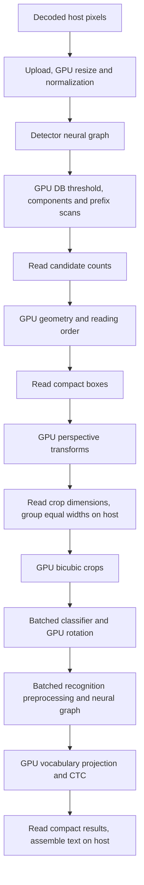

GPU backend review after the first optimization pass — 2026-10-24

Follow-up: the [convolution implementation and results](gpu-register-optimization-2026-10-24.md)
apply the recommendations below. This review retains the pre-change measurements
at `21971c5` for comparison.

There is still substantial room to improve GPU OCR speed. Recognition
convolutions are the main target; detector convolutions matter particularly for
Medium. A larger recognition batch already gives a measured 8.7% latency
reduction on the dense fixture. More GPU slots remove cache misses but do not
improve latency on the typical fixture in this run.

This review measures production code at `21971c5`, which already includes
classifier batching, tiled 2×2 convolutions, and direct NCHW pointwise addressing
for large Metal recognition layers. These are existing optimizations, not new
recommendations. The earlier [baseline](gpu-backend-analysis-2026-10-24.md) and
[optimization report](gpu-optimization-2026-10-24.md) describe earlier versions;
their timing samples are not pooled with this review.

Only the benchmark example changed: `sample_run_statistics` now captures
per-invocation counters outside the timed interval. No runtime, shader, model,
precision policy, or default setting changed.

**Local measurements and their scope**

Physical Mac mini, Apple M4, 10 GPU cores, 16 GiB unified memory, macOS 27.0.1
(26A434), Metal, wgpu 30.0.1, pinned nightly-2026-09-08, release builds with all
features and locked dependencies. CPU settings are four line workers, eight
detector threads, and sixteen preprocessing workers. Baseline GPU settings are
FP32, one request, one GPU slot, recognition batch size two, and CTC span capture
enabled. Default optional subgroup/cooperative-matrix/scratch-cache settings
remain disabled.

The typical input is the repository's 500×500 sample, with 16 lines. Dense is a
1000×1000 2×2 repetition, with 64 lines. Detector tensors are 512×512 and
960×960. These are two related fixtures, not a diverse document corpus. Each
configuration has one cold correctness/warm-up invocation, three uninstrumented
warm measurements, and one separate profiled invocation. Timings include OCR
execution and worker launch; they exclude image decoding, model construction,
owned-result conversion, output validation, serialization, and profile calls.

| Workload | SIMD CPU median ms | Full GPU median ms | GPU / CPU latency | Full GPU warm samples, ms |
|---|---:|---:|---:|---|
| Tiny, typical | 49.97 | 72.51 | 1.45× | 72.510, 72.227, 74.056 |
| Small, typical | 124.05 | 227.33 | 1.83× | 226.567, 227.325, 228.266 |
| Medium, typical | 351.04 | 897.95 | 2.56× | 897.951, 896.523, 905.032 |
| Tiny, dense | 173.17 | 241.15 | 1.39× | 243.434, 237.659, 241.154 |

Tiny's inference-only GPU mode takes 107.51 ms (108.704, 106.928, 107.509).
Full GPU is 32.6% faster on that input. Full mode's residency, GPU postprocessing,
and classifier batching therefore have practical value, but the current CPU
path remains faster on every measured workload. The mode comparison changes
several stages together and does not isolate transfer savings.

**Execution path and stage costs**

The table below sums device timestamps from the separate Full profiles. It is
not an additive decomposition of warm wall latency. On this backend, profiling
splits neural execution into individual measured passes; normal execution can
keep consecutive dispatches in one pass (`gpu.rs:1970`). Profiled wall times are
85.71, 252.58, and 928.16 ms for typical Tiny/Small/Medium, and 254.82 ms for dense
Tiny. Profiling affects scheduling and overhead.

| Stage | Tiny typical ms | Small typical ms | Medium typical ms | Tiny dense ms |
|---|---:|---:|---:|---:|
| Image resize, normalization, crops and rotation | 1.47 | 2.84* | 7.04* | 6.43 |
| Detector neural graph | 11.93 | 27.58 | 163.63 | 35.77 |
| DB geometry and reading order | 2.45* | 2.37* | 2.32* | 4.55* |
| Orientation classifier backbone | 6.28 | 6.08 | 6.09 | 24.22 |
| Recognizer neural graph | 44.26 | 171.38 | 699.20 | 144.26 |
| Vocabulary/classifier projection | 6.88 | 20.94 | 34.98 | 24.11 |
| CTC | 0.069* | 0.220* | 0.794* | 0.198* |

`*` Incomplete timestamp coverage. Tiny/Small/Medium typical profiles have
9/8/3 unavailable records; dense Tiny has 15. Missing records belong to geometry,
transform metadata, or CTC; all neural-graph and projection records are present.
Unavailable durations are omitted, not counted as measured zero. Small
sub-millisecond stages should not be ranked by these sparse, single-call samples.

| Link or stage | Current implementation | Optimization assessment |
|---|---|---|
| Model import, compilation, pipeline creation | `runtime/compiler.rs`, `gpu.rs:706`, `gpu/pipelines.rs:12`: shared logical graphs, context/precision-specific weights, shared pipelines and heads. The portable foundation eagerly builds 27 shader kinds. | Reuse `OcrPlan`, context, and requests. Lazy creation of unused pipelines is a startup candidate; no warm-latency benefit has been demonstrated. |
| Physical lowering and storage | `gpu/physical.rs`, `gpu/fusions.rs`, `gpu/storage.rs`: convolution epilogues, SE, layer norm, attention/view folding, reshape aliases, compatible concat placement, and liveness-based buffer reuse. | Basic fusion and residency already exist. Target measured kernels rather than adding generic fusion indiscriminately. |
| Image upload and preprocessing | `gpu/resident.rs`, `gpu/image.wgsl`: upload the source once, resize in the byte domain, normalize into resident tensors. Upload also creates an aligned host copy. | All image device work is only 1.47–7.04 ms on typical pages. Fusing selected crop/rotation/normalization operations could reduce allocations and traffic, but must retain byte rounding and crop semantics. Lower priority than convolution. Decoding is outside this benchmark. |
| Detector inference | `gpu/vision.rs:29`, convolution/depthwise/transposed kernels. | Medium is expensive: 163.63 ms. Its 3×3 head convolution and generic 5×5/7×7 layers are concrete targets, detailed below. |
| DB postprocessing | `gpu/vision.rs:320`, `db_label`, `db_rows`, `db_geometry`, `db_sort` shaders. Tiled components and hierarchical prefix scans already exist; hull/rectangle/scoring work is serial within a candidate, reading order uses one invocation. | Potential for geometrically complex pages, but only about 2.3–4.6 ms here. Do not prioritize a scan rewrite for these workloads. |
| Perspective crop and width selection | `gpu/vision.rs:135`, `crop_meta.wgsl`, `crop.wgsl`, `ocr/gpu.rs:222`. GPU computes transforms and crop dimensions; host validates sizes and groups equal tensor widths. | Compact metadata creates synchronization boundaries. Combining boundaries or reusing buffers may help, but neither payload volume nor current image time is the dominant cost. |
| Orientation classification | `ocr/gpu.rs:292`, `gpu/heads.rs:277`: fixed batches of up to four, independent of recognition widths; tail rows ignored and rotation reads the corresponding winner row. | Existing batching has removed the previous batch-one bottleneck. Current cost is about 6 ms for 16 lines and 24 ms for 64. Further batch/rotation fusion is secondary. Preserve bounded lookahead and queued parameter lifetimes. |
| Recognition preprocessing and backbone | `gpu/heads.rs:450`, `gpu/operators.rs:781`, `gpu/tiled.wgsl`. Equal-width batching, shape-selected kernels, compact feature output. | Main target: 60%, 74%, and 76% of known device time for Tiny/Small/Medium. Pointwise convolutions dominate; small generic kernels and dense 3×3 layers are additional targets. |
| Attention, reductions and layout handling | Existing online attention, layer norm, SE and reduction fusions; FP32 measured runs have zero layout conversions. | Attention costs 2.31 ms for Small and 2.81 ms for Medium; layer norm costs 0.36/0.40 ms. These are much smaller than convolution. A global layout change needs its own measured justification. |
| Vocabulary projection | `gpu/heads.rs:112`, `heads4.wgsl`, `head_reduce.wgsl`: four-row weight reuse for eligible large FP32 heads, partial winners and stable full-vocabulary probability normalization. | Useful second-tier target: 6.88/20.94/34.98 ms including classifier projection. Investigate feature/weight reuse and reduction organization while preserving lowest-index ties, confidences and error handling. |
| CTC and host result assembly | `ctc.wgsl`, `gpu/heads.rs:495`, `ocr/gpu.rs:410`: GPU compacts blanks/repeats/spans; host reads tokens and assembles dictionary text in reading order. | No evidence to prioritize CTC. Host mapped-read handling is 0.011/0.016/0.023 ms in typical profiles, but that excludes waiting and does not separately measure all text assembly. Zero CPU stage fields in Full profiles are not measurements of zero host work. |
| Encoding, submissions, admission | `gpu/resident.rs:550`, `ocr/gpu.rs:312`: resident dispatches create parameter buffers/bind groups; graph bindings are reused when compatible. Three initial readback boundaries precede recognition waves; at most two waves remain pending. | Parameter arenas and cached shader-source strings are plausible follow-ups. Two slots reduce submissions but showed no speedup here. Completion wait overlaps GPU work and cannot be added to device time as an independent overhead. |
| Shape cache and allocation reuse | `gpu.rs:39,1545`: eight previous plans plus current; generation-sensitive bindings. Scratch caching is available but defaults off. | Confirmed repeated cache misses, but their time cost remains unisolated. Maintain bounded memory. Scratch reuse also clears buffers, so fewer allocations do not automatically imply less work. |
| Precision and fallback | Full detector and recognizer call `with_full_precision`; mixed storage uses FP32 accumulation. Strict GPU errors remain visible; Auto fallback is restricted by error/stage policy. | FP16 is not a general Full DET/REC speed switch. Any reduced-precision experiment must qualify boxes, text, confidence and CTC spans. All measured Full runs used GPU compute with no CPU fallback or diagnostic tensor download. |

**Convolution targets supported by current profiles**

Recognition pointwise kernels consume 25.32/105.81/519.79 ms for typical
Tiny/Small/Medium, respectively: approximately 35%/46%/57% of known device time.
Medium's four recognition nodes 300, 309, 317 and 326 alone cost 115.29 ms across
the page. They expand 768→1536 or reduce 1536→768 channels at height three.
Other costly Medium layers operate at height six with 512/1024 channels.
Node numbers here are zero-based original ONNX indices, verified against the
current model hashes, and include fused epilogues where shown in the raw profile.

The current direct pointwise kernel removes spatial division and bounds work,
but still uses a 16-element reduction tile, 64 threads, shared-memory barriers,
and 16×16 or 32×32 output tiles. The next experiment should target register/load
reuse and shape-specific tile geometry on inputs such as `[1,1536,3,240]→768`
and `[1,1024,6,240]→512`. Simply increasing the reduction tile to 32 or converting
to NHWC is not an established improvement: the previous optimization report
records rejected versions of those approaches. Hardware counters were not
collected here, so the profiles do not distinguish arithmetic, memory bandwidth,
or occupancy as the limiting mechanism.

| Additional concrete target | Current measured device cost | Reason to investigate |
|---|---:|---|
| Medium DET node 268: 256→64, 3×3, output `[1,64,128,128]` | 21.83 ms | Largest single detector dispatch; currently uses implicit 16×16 tiling. |
| Medium DET nodes 246 / 251: 32→32, 7×7 / 5×5 | 15.40 / 8.48 ms | Dense kernels remain generic because the tiled selector admits only square 1×1–3×3 kernels. |
| Medium DET node 172: depthwise 9×9, 256 channels | 6.55 ms | Specialized depthwise kernels currently cover only 3×3 and 5×5. Lower priority than the preceding rows. |
| Small REC node 19: 96→48, 3×3 stride two | 10.04 ms across the page | A significant implicit-tiled layer after the existing 2×2 optimization. |
| All generic REC convolutions, Tiny / Small / Medium | 9.26 / 17.95 / 40.04 ms | Includes RGB stems and small pointwise shapes excluded by channel/tile-count guards; these require distinct targeted treatments. |

For example, Tiny recognition node 206 is a 160→160 pointwise layer with height
one and costs 1.75 ms. A batch-one width-124 output has only `10 × 8 = 80`
16×16 tile groups, below the selector's fixed minimum of 128. This is a concrete
small-matrix selection experiment, not grounds to lower that guard globally.
RGB stems have only three input channels and fail a different eligibility guard.

The optimized 2×2 layers are no longer the same opportunity reported in the
baseline: Small recognition nodes 4/8 now total 10.93 ms, and Medium detection
nodes 2/4 total 9.97 ms in this review.

For scale, halving all recognition pointwise time with everything else unchanged
would yield about 1.21×/1.30×/1.40× speedup in known device work for the three
presets. This is an Amdahl scenario, not a predicted wall-latency gain or evidence
that a 2× kernel improvement is achievable. It does not establish that GPU would
overtake CPU.

**Two bounded configuration experiments**

| Change, otherwise identical settings | Baseline median ms | Candidate median ms | Result |
|---|---:|---:|---|
| Tiny dense: recognition batch 2 → 8, one GPU slot | 241.15 | 220.28 | 8.7% lower latency, 1.095× sequential throughput |
| Tiny typical: GPU slots 1 → 2, recognition batch 2 | 72.51 | 72.54 | No measurable gain; sample ranges overlap |

Batch-eight samples are 219.981, 220.275 and 221.631 ms. Two-slot samples are
71.022, 73.140 and 72.539 ms. All passed the CPU-output gates, repeated-output
checks and profiled-output checks. No unchanged configuration was rerun to
improve the reported numbers.

The dense fixture has 15 distinct recognition widths. Batch two produces 32
recognition units; batch eight produces 15, with an average 4.27 crops per unit.
Submissions fall from 35 to 18, dispatches from 2,855 to 1,869, and scratch
allocations from 299 to 231. Recognition device time falls from 144.26 to
126.78 ms in the separate profiles. Peak application-accounted GPU allocation
increases from 118.95 to 126.68 MiB. This supports trying
`.recognition_batch_size(8)` for dense documents with repeated widths; it does
not justify a universal new default.

Typical Tiny and Small each have 13 recognition units. Medium also has 13 units,
including separate batch-one and batch-two work at one width. With one slot,
every warm invocation of each preset has **0 recognition cache hits and 13
misses**. Detector/classifier sessions each have one hit and zero misses.
With two slots, Tiny has 7 and 6 recognition hits in the respective sessions and
zero misses; submissions fall from 16 to 10. Peak allocation rises from 41.87
to 44.63 MiB, and latency is unchanged within observed noise. This confirms
cache churn but gives no basis to promise a large latency benefit from enlarging
the cache. The slot experiment also changes scheduling and storage, so it does
not isolate cache cost.

Batching across unequal widths is a separate, higher-risk change: extra padding
can affect model computations and CTC time steps. Preserve the current width
contract unless a masked/bucketed implementation passes whole-OCR validation.

**Transfers, memory, and startup**

| Full configuration | Upload bytes | Output + control bytes | Submissions | Dispatches | Scratch allocations | Retained / peak MiB |
|---|---:|---:|---:|---:|---:|---:|
| Tiny typical, batch 2, one slot | 750,000 | 28,144 | 16 | 1,102 | 103 | 36.86 / 41.87 |
| Small typical, batch 2, one slot | 750,000 | 26,896 | 16 | 2,012 | 103 | 81.19 / 91.35 |
| Medium typical, batch 2, one slot | 750,000 | 29,584 | 16 | 2,100 | 103 | 233.64 / 247.29 |
| Tiny dense, batch 2, one slot | 3,000,000 | 110,032 | 35 | 2,855 | 299 | 101.16 / 118.95 |
| Tiny dense, batch 8, one slot | 3,000,000 | 110,032 | 18 | 1,869 | 231 | 108.90 / 126.68 |

Payload counters are not physical memory-bus traffic measurements. Accounted
memory excludes opaque driver allocations; scratch counts exclude some
parameter, bind-group and readback allocations. The full vocabulary logits and
intermediate feature/image tensors remain on the device. There is little
evidence that shrinking readback payloads is the next major speed improvement.

Typical profiles record 1.82/2.33/2.63 ms of host encoding and
15.79/31.28/37.38 ms of submission time. These belong to the heavily instrumented
calls, not ordinary inference overhead, and do not separately measure all shape
binding. They must not be subtracted from warm latency to invent a CPU/GPU
breakdown.

Full construction took 538.32/44.24/94.48 ms, and first inference
341.84/243.99/923.62 ms for typical Tiny/Small/Medium. Driver caches were not reset;
these are observed process/request cold values, not controlled first-install
results or a fair cross-preset startup comparison. Plan/context/request reuse is
already supported. Evaluate lazy pipeline compilation separately if startup is
an application requirement.

**Recommended order of work**

1. For deployments on this machine, keep CPU as the latency choice on these
   workloads. Where GPU is required, evaluate recognition batch eight on the
   application's dense-document corpus; this is the improvement actually
   demonstrated here.
2. For GPU kernel development, prioritize recognition pointwise kernels on the
   measured short feature maps, followed by the specific detector 3×3 and dense
   5×5/7×7 kernels. Tiny also merits a small-matrix/RGB-stem experiment.
3. Improve projection reuse after, or independently of, the neural kernels when
   focusing on Tiny/Small. Preserve full-vocabulary confidences and CTC semantics.
4. Treat cache capacity, allocation reuse, submission grouping, further classifier
   batching, and preprocessing fusion as secondary experiments. Cache misses and
   allocation counts alone do not establish a worthwhile speedup.
5. Require focused numerical correctness, then a bounded whole-stage comparison
   and uninstrumented OCR gain before accepting a kernel or changing a default.
   Keep each experiment to the actual hot shapes, one warm-up and three samples;
   preserve the local execution budget and memory bounds.

**Validation and reproducibility**

Four fresh CPU-versus-Full comparisons passed: all three presets on typical and
Tiny on dense, one invocation per placement. These check text, counts, ordering,
classification/rotation, recognition widths, time steps, CTC spans and scores.
Maximum box-coordinate difference was zero pixels. FP32 score gates use
`abs_error <= 0.001 + 0.001 * abs(reference)`.

Three focused physical-GPU tests passed once each: batched classifier rows/tails,
dense 2×2 padding/channel tails, and compact projection/CTC. The 2×2 test also
exercises mixed storage. All eleven benchmark configurations passed their CPU
reference checks and deterministic warm/profile output checks. That is 33 warm
measurements, 11 cold/warm-up calls and 11 separate profile calls. All Full cases
reported GPU placement, no CPU compute stages, and zero diagnostic readbacks.
The changed benchmark passes release Clippy with warnings denied, formatting,
and `git diff --check`. The full regression suite was not rerun for this
benchmark-only change.

Total performance harness execution was **18.62 seconds**, including process
startup, cold/profile calls and harness work; builds and separate correctness
checks are excluded. No CI, remote runner, VM, automatic sampling growth, or
additional timing repetitions were used. Three warm samples establish a local
observation, not a confidence interval. Independent documents, Vulkan/DX12,
mixed-precision performance, concurrent request throughput, and hardware-counter
analysis remain unmeasured in this review.

Local evidence is under `reports/gpu-current-review-2026-10-24/` (ignored):
`summary.json`, `summarize.py`, `performance-budget.json`, `focused-tests.json`,
qualification manifests, raw outputs, and per-experiment manifests in
`typical`, `dense`, `hybrid`, `slots`, and `batch`. Performance manifests preserve
exact commands, source archives/hashes, frozen executables, models, dictionaries,
input pixels and raw samples. The reused ONNX inventory was checked against all
current model hashes. Run `python3 reports/gpu-current-review-2026-10-24/summarize.py`
to reconstruct the aggregate evidence without rerunning inference.
