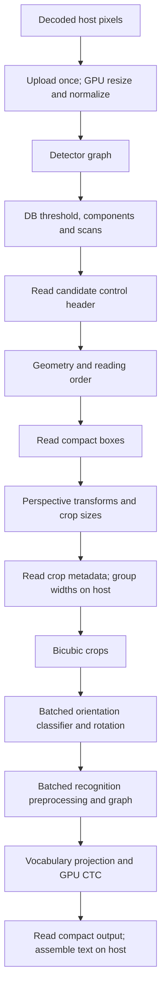

# GPU backend stage audit — 2026-10-24

Follow-up: the [GPU recognition optimization](gpu-recognition-optimization-2026-10-24.md)
implements the selected improvements and records final validation and results.
This audit retains the preceding `a7930a4` measurements as its baseline.

There is substantial remaining GPU optimization potential, concentrated in
recognition convolutions. On the physical Apple M4, current full-GPU OCR takes
71.82 / 206.38 / 723.02 ms for Tiny / Small / Medium on the typical input;
the SIMD CPU takes 51.09 / 128.81 / 355.26 ms. Recognition consumes
59.4% / 71.5% / 75.4% of available device timestamp time. A dense-document
configuration experiment reduces Tiny latency by 8.6% by increasing recognition
batch size from two to eight. Kernel recommendations below are candidates for
future experiments; their speedups have not been measured or implemented here.

The audited runtime is `a7930a4` (`perf(gpu): accelerate pointwise and spatial
convolutions`). It already includes register-blocked pointwise convolution,
larger spatial tiles, classifier batching, graph fusion, compact GPU projection
and CTC, and resident image processing. The earlier
[backend review](gpu-current-review-2026-10-24.md) predates the latest kernels;
the [convolution optimization report](gpu-register-optimization-2026-10-24.md)
describes their implementation. This audit uses fresh measurements separately
from those historical samples. Production code and defaults were unchanged.

All execution was local on a physical Mac mini, Apple M4, 10 GPU cores,
16 GiB unified memory, Metal, wgpu 30.0.1, macOS 27, and pinned
nightly-2026-09-08. Builds used `--release --locked --all-features`.
The baseline is FP32, one request, one GPU slot, recognition batch two, span
capture enabled, and the default Logit recognition score mode. CPU settings are
four line workers, eight detector threads and sixteen preprocessing workers.
Optional subgroup, cooperative-matrix and scratch-cache settings remain off.
These measurements qualify this machine; Vulkan, DX12 and other devices were
not tested.

The typical input is the repository's 500×500 sample with 16 detected lines.
Dense is its deterministic 1000×1000 2×2 repetition, with 64 lines. Detector
tensors are 512×512 and 960×960. A rotated version was used only for Tiny
correctness. These related fixtures do not establish accuracy or performance
on a diverse document corpus.

Each timed configuration had one cold correctness/warm-up invocation, three
ordinary warm measurements, and one separate profiled invocation. There were
ten configurations: typical CPU/Full for three presets, typical Tiny
InferenceOnly, dense Tiny CPU/Full, and dense Tiny Full with batch eight.
Total performance execution, including all harness invocations, startup,
warm-ups and profiles, was **16.5 seconds**, within a single 59-second
declared budget. No adaptive loops or repeated attempts for cleaner numbers
were used. Correctness checks were separate from latency measurements.

| Workload | SIMD CPU median ms | Full GPU median ms | GPU / CPU latency | Full GPU warm samples ms |
|---|---:|---:|---:|---|
| Tiny, typical | 51.086 | 71.822 | 1.406× | 72.445, 71.822, 70.231 |
| Small, typical | 128.813 | 206.378 | 1.602× | 206.378, 208.864, 203.936 |
| Medium, typical | 355.255 | 723.023 | 2.035× | 723.023, 718.420, 724.552 |
| Tiny, dense, batch 2 | 173.165 | 228.800 | 1.321× | 231.465, 227.087, 228.800 |
| Tiny, dense, batch 8 | 173.165¹ | 209.215 | 1.208× | 209.215, 214.983, 208.933 |

¹ The CPU value is the batch-two comparator, reused for context. The batch-eight
experiment compares GPU batch two with GPU batch eight; no CPU batch-eight
measurement was performed.

The measured interval includes worker launch and OCR execution through inference
return. It excludes decoding, model/request construction, owned-result copying,
validation, serialization and the separate profile calls. Cold Tiny Full
inference was 340.83 ms and construction was 538.70 ms in this run; persistent
plan/context/request reuse matters for interactive use. Driver caches were not
reset, so these are observed process/request startup values, not controlled
first-install measurements.

Full Tiny is 31.8% faster than InferenceOnly on typical: 71.822 versus
105.276 ms (InferenceOnly samples 105.276, 106.933, 104.010). This comparison
changes residency, preprocessing, postprocessing and batching together, so it
does not isolate transfer savings. InferenceOnly profile coverage omits neural
records; its empty pipeline fields do not mean it performed no GPU work.

The full execution path is:



The following device durations come from the separate instrumented Full calls.
They rank work but are **not an additive decomposition of ordinary warm wall
latency**. On Metal, profiling splits neural dispatches into individual passes;
ordinary execution groups consecutive dispatches in one pass
([gpu.rs](../src/runtime/gpu.rs), lines 1970–2040). Profile wall times were
80.36 / 236.26 / 745.37 ms for typical Tiny / Small / Medium, and
246.27 / 229.80 ms for dense batch two / eight.

| Device stage, ms | Tiny typical | Small typical | Medium typical | Tiny dense b2 | Tiny dense b8 |
|---|---:|---:|---:|---:|---:|
| Image normalization, crops, rotation and metadata | 1.472* | 3.015* | 10.721* | 5.969 | 7.072 |
| Detector graph | 11.339 | 27.575 | 127.900 | 37.640 | 35.799 |
| DB components, geometry and reading order | 2.446* | 2.525* | 2.278* | 4.464* | 4.577* |
| Orientation classifier graph | 6.192 | 6.131 | 6.090 | 25.050 | 24.539 |
| Recognizer graph | 40.527 | 152.626 | 556.215 | 132.620 | 121.170 |
| Vocabulary + classifier projection | 6.169 | 21.356 | 34.265 | 23.601 | 24.057 |
| CTC | 0.112* | 0.276* | 0.275* | 0.150* | 0.139* |

`*` Incomplete timestamp coverage: 6 / 3 / 7 / 22 / 5 unavailable records,
respectively. All neural-graph and projection timestamps are present. Missing
records occur in DB, transform metadata or CTC and are excluded from sums.
Small stage differences, including image-work variation, should not be ranked
from these single profiles. No hardware bandwidth/occupancy counters were
collected, so a high kernel duration does not establish its hardware limit.

| Link or stage | Current implementation | Optimization assessment |
|---|---|---|
| Import and shared compilation | [compiler.rs](../src/runtime/compiler.rs), [graph.rs](../src/runtime/graph.rs), [gpu.rs](../src/runtime/gpu.rs): common graph validation, context/precision-specific immutable weights, reusable plans and exclusive mutable requests. | Reuse these objects. Weight upload and compilation are startup work; they are not repeated per line. |
| Pipeline creation | [pipelines.rs](../src/runtime/gpu/pipelines.rs), lines 12–25: per-context cache, eager FP32 portable foundation and lazy variants. | Lazy creation of unused shaders could reduce startup. Warm benefit is unmeasured. |
| Shape lowering, fusion and storage | [physical.rs](../src/runtime/gpu/physical.rs), [fusions.rs](../src/runtime/gpu/fusions.rs), [storage.rs](../src/runtime/gpu/storage.rs): fused convolution epilogues, SE/layer norm/attention, movement aliases, concat placement and liveness reuse. | These optimizations already exist. All measured Full FP32 runs report zero layout conversions; a global layout rewrite needs measured justification. |
| Host image upload | [resident.rs](../src/runtime/gpu/resident.rs), lines 132–149: padded host copy and one source-image upload into a new buffer. | A reusable upload buffer could reduce allocation/copy overhead. Transfer counters do not measure physical unified-memory bandwidth. |
| Detector preprocessing | [resident.rs](../src/runtime/gpu/resident.rs), lines 931–1012, [image.wgsl](../src/runtime/gpu/image.wgsl): byte-domain bilinear resize, channel ordering, padding and normalization into resident input. | Fusion is already present. Preserve byte rounding and integer resize semantics. Lower priority than convolution. |
| Detector graph | [vision.rs](../src/runtime/gpu/vision.rs), lines 24–65: resident F32 graph, tiled/direct/depthwise/transposed kernels. | Medium's 127.90 ms warrants work on selected convolution shapes; its earlier dense 5×5/7×7 tiling has already been improved. |
| DB threshold/components/scans | [vision.rs](../src/runtime/gpu/vision.rs), lines 337–409, [db_label.wgsl](../src/runtime/gpu/db_label.wgsl): ten ordered dispatches with local union, boundary union, compression and hierarchical scans. | Existing parallel component extraction is useful. Current combined geometry time gives no reason to prioritize a general scan rewrite. |
| DB geometry and reading order | [db_geometry.wgsl](../src/runtime/gpu/db_geometry.wgsl), lines 45–99 and 132–145: serial hull/rectangle/scoring within each candidate; [db_sort.wgsl](../src/runtime/gpu/db_sort.wgsl), lines 38–44: single-invocation ordering. | More complex contours or many candidates could expose a bottleneck. Parallelization must preserve canonical geometry, compensated score accumulation and reading order. |
| Perspective metadata and crop | [vision.rs](../src/runtime/gpu/vision.rs), lines 135–200, [crop_meta.wgsl](../src/runtime/gpu/crop_meta.wgsl), [crop.wgsl](../src/runtime/gpu/crop.wgsl): GPU precise transforms/dimensions, host validation/grouping, then bicubic crop pixels. | Combine transform/shape generation with the box-producing submission to remove one host wait. This is a design candidate; savings are unmeasured. |
| Classifier | [ocr/gpu.rs](../src/ocr/gpu.rs), lines 289–299, [heads.rs](../src/runtime/gpu/heads.rs), lines 275–335: fixed-shape batches of up to four crops. | Batch-one classification has already been removed. Costs about 6 ms for 16 lines and 25 ms for 64; secondary priority. |
| Orientation rotation | [vision.rs](../src/runtime/gpu/vision.rs), lines 298–317, [rotate.wgsl](../src/runtime/gpu/rotate.wgsl): copies each crop, including unchanged orientation. | Fold winner-dependent source coordinates into recognition preprocessing to avoid the extra copy/dispatch. Preserve threshold and resize rounding. |
| Recognition grouping/preprocessing | [ocr/gpu.rs](../src/ocr/gpu.rs), lines 240–260, [heads.rs](../src/runtime/gpu/heads.rs), lines 450–481: equal tensor widths batched, widths rounded to 32, resident normalization and F32 graph. | Batch eight improves the measured repeated-width dense case. Padding unequal widths could change model outputs/CTC steps and needs a separate contract and accuracy study. |
| Recognizer graph | [operators.rs](../src/runtime/gpu/operators.rs), lines 784–894, [physical.rs](../src/runtime/gpu/physical.rs), lines 336–379, [pointwise_blocked.wgsl](../src/runtime/gpu/pointwise_blocked.wgsl). | Highest priority: tune remaining pointwise hot shapes and shape-selection gaps described below. |
| Attention/reductions | [attention.wgsl](../src/runtime/gpu/attention.wgsl), [fusions.rs](../src/runtime/gpu/fusions.rs): online attention, layer norm and reduction specializations. | Small/Medium recognition attention costs 2.48/2.84 ms and layer norm 0.36/0.40 ms. Much smaller targets than convolution. |
| Vocabulary projection | [heads.rs](../src/runtime/gpu/heads.rs), lines 129–197, [heads4.wgsl](../src/runtime/gpu/heads4.wgsl), [head_reduce.wgsl](../src/runtime/gpu/head_reduce.wgsl): 64-class tiles, four-row reuse for eligible heads, compact maxima and optional full-vocabulary probability normalization. | Useful second-tier target; preserve lowest-class ties, invalid-score detection, Logit scores and Probability normalization. |
| CTC and public result | [ctc.wgsl](../src/runtime/gpu/ctc.wgsl), [ocr/gpu.rs](../src/ocr/gpu.rs), lines 408–552: device compaction, compact readback, dictionary/text/span assembly on host. | No measured reason to optimize CTC first. Full profile CPU stage fields left at zero are missing instrumentation, not zero host work. |
| Encoding, allocation and scheduling | [resident.rs](../src/runtime/gpu/resident.rs), lines 552–600: fresh 1 KiB uniform packet and bind group per resident dispatch. [ocr/gpu.rs](../src/ocr/gpu.rs), lines 309–406: at most two waves pending. | Parameter arenas and binding/source reuse are secondary experiments. Preserve queued parameter lifetimes and bounded memory. |
| Precision/fallback | Full detector and recognizer explicitly use full-precision compiled variants; strict GPU errors remain visible, Auto fallback is restricted. | Enabling f16 alone does not accelerate Full DET/REC. Hardware-matrix convolution or reduced precision needs numerical and whole-OCR qualification. All measured Full runs had no CPU compute stages or diagnostic tensor downloads. |

The strongest remaining kernel candidates are precise shape/selection gaps,
followed by further tuning of already optimized kernels. ONNX indices below
are zero-based original node indices; durations aggregate their dispatches
across all recognition batches on the typical page, including fused epilogues.

| Candidate | Fresh evidence | Bounded next experiment |
|---|---|---|
| Further recognition pointwise reuse | Direct/register pointwise totals 22.564 / 85.658 / 384.944 ms for Tiny / Small / Medium. Medium blocked32 alone is 338.312 ms. | Use 1–3 actual hot shapes to test tile geometry, operand loading or reduction organization. The current shader already has four-by-four register blocks, K=16 and two barriers per K tile; larger K is unproven. |
| Medium H=12 pointwise selection | REC nodes 83/112 are **512→256 1×1**, costing 19.116/19.274 ms, with output `[N,256,12,W]`. They still use implicit32. | Test direct/blocked addressing at these shapes. `physical.rs:354` excludes input channels above 256 when H>6. These are pointwise layers, not spatial 3×3 layers. |
| H=1 narrow pointwise selection | Tiny node 206: 160→160, 1.748 ms. Small 305/309: 384→120, 3.266/3.216 ms. Medium 332/336: 768→192, 10.354/10.191 ms. | A dedicated narrow kernel/policy may beat generic convolution. `operators.rs:875` rejects fewer than 128 tile16 groups; Medium N=1,W=124 has only 96 groups. Avoid lowering the guard globally without shape evidence. |
| RGB recognition stems | Node 0 remains generic; 2.025/4.325/5.777 ms for Tiny/Small/Medium. Input channels=3 fails the tiled path's `cpg>=8` guard. | Test an RGB stem specialization on actual stride/padding and 1–3 widths. |
| Small recognition spatial convolution | Node 19's implicit16 portion costs 10.017 ms; existing optimized 2×2 nodes 4/8 cost 6.085/5.217 ms. | Compare shape-specific reuse/tile choices for the actual 3×3 stride-two node before broad changes. |
| Medium detector kernels | Node 268 is improved tile32 3×3, 11.755 ms. Node 172 is generic 256-channel depthwise 9×9, 6.833 ms. | Test depthwise 9×9 reuse or the remaining tile32 bottleneck. Dense 7×7/5×5 nodes 246/251 already use tile32 and cost 4.071/2.099 ms. |
| Default Logit projection fast path | `heads.wgsl:30` expresses `exp` inside `select`; both head shaders still execute the probability sum-reduction/barrier section when probability is false. `head_reduce.wgsl` already guards its probability normalization. | Add a workgroup-uniform Logit fast path around unused probability work. Device compiler savings and speedup remain unmeasured; retain full Probability behavior. |

For scale, halving only the measured direct/register recognition pointwise
time, with all other available device work unchanged, would imply about
1.20× / 1.25× / 1.35× improvement in that device-time sum. This Amdahl scenario
is not a forecast of achievable kernel gain, ordinary wall speedup, or GPU
overtaking CPU. It shows why pointwise kernels outrank CTC and small transfers.

The dense batch experiment is the improvement demonstrated in this audit.
Batch eight reduces the median 228.800→209.215 ms, an 8.56% latency reduction
and 1.094× sequential throughput. The warm sample ranges do not overlap, but
there are only three samples and one related dense fixture. It is appropriate
to evaluate `.recognition_batch_size(8)` on repeated-width deployment documents;
this does not justify a universal default change.

| Full configuration | Submissions | Dispatches | Scratch allocations | Upload bytes | Output + control bytes | Retained / peak MiB |
|---|---:|---:|---:|---:|---:|---:|
| Tiny typical, b2 | 16 | 1,102 | 103 | 750,000 | 28,144 | 36.86 / 41.87 |
| Small typical, b2 | 16 | 2,012 | 103 | 750,000 | 26,896 | 81.19 / 91.35 |
| Medium typical, b2 | 16 | 2,100 | 103 | 750,000 | 29,584 | 233.64 / 247.29 |
| Tiny dense, b2 | 35 | 2,855 | 299 | 3,000,000 | 110,032 | 101.16 / 118.95 |
| Tiny dense, b8 | 18 | 1,869 | 231 | 3,000,000 | 110,032 | 108.90 / 126.68 |

Dense has 15 tensor widths. Batch eight turns 32 recognition units into 15,
and separate profile recognition time falls 132.620→121.170 ms. Peak accounted
allocation grows by 7.73 MiB. Device-memory counters exclude opaque driver
allocations; scratch counts omit some uniform, binding and readback objects.
Payload counters do not measure bus traffic. Dense batch-eight outputs passed
the benchmark's CPU-reference gates for scores, text, ordering, rotation,
widths/time steps and spans.

Typical warm calls still have zero recognition plan-cache hits and 13 misses
per request; DET/CLS each have one hit and zero misses. Dense has 17 hits /
15 misses at b2 and zero hits / 15 misses at b8. Cache hits alone therefore
do not predict speed: b8 is faster despite fewer hits. The cache retains the
current shape plus eight previous shapes. Earlier slot experiments on
`21971c5` did not demonstrate a latency gain, so this audit did not rerun
them or recommend a larger cache/default slot count solely from miss counts.

A nonempty page has three host-visible boundaries before recognition:
16-byte DB control readback; `64×(candidate_count+1)` bytes of sorted DB output;
and `24×accepted_count` bytes of crop metadata. Each recognition wave adds a
compact result readback. Computing transforms/sizes after sorting within the
second submission, alongside box output, could remove the third boundary while
retaining device coefficients and host resource/shape checks. It needs a
focused synchronization experiment before assigning a benefit.

Profiled host encoding is 1.69 / 2.40 / 2.71 ms for typical Tiny / Small /
Medium; submission counters are 15.24 / 34.49 / 38.23 ms. These are affected
by profiling's pass structure. Completion wait overlaps outstanding GPU work
and cannot be added to device time as separate overhead. Mapped-buffer handling
is 0.011 / 0.019 / 0.027 ms, which excludes waiting and does not isolate all
text assembly. These numbers do not establish a transfer-bound pipeline.

Correctness was checked before performance. Three focused physical Metal
numerical tests passed: pointwise tails/bias/offsets, pointwise fusion/selection,
and large spatial tiles with padding/stride/tails. Five fresh CPU-versus-Full
OCR comparisons passed: typical on all three presets, plus Tiny dense and
vertical. They cover text, counts/order, classification and rotation,
recognition widths/time steps, CTC spans and scores; maximum coordinate error
was zero. FP32 score checks use `abs_error <= 0.001 + 0.001*abs(reference)`.
Every benchmark configuration passed its CPU-output gate, exact repeated-output
check, and profile-output check. Semantic `errors` and `qualified` fields were
explicitly checked; successful process exit alone is insufficient for these
harnesses.

**One profiling-availability check failed.**
`gpu_hardware_profile_and_warmed_shape_bindings_are_bounded` failed at
`tests.rs:666`, requiring `compute_ns().is_some_and(|ns| ns > 0)` for a tiny
ReLU graph. Its earlier shape/cache/buffer-identity assertions passed; later
profile-reset assertions were not reached. The log does not distinguish an
unavailable aggregate from a zero duration. The exact cause was not established
and no driver bug or OCR numerical defect is inferred. The benchmark's full
neural/projection timing coverage remains available, with missing records
reported above. An initial test invocation without the backend environment
selected unsupported Vulkan; explicit Metal runs produced the numerical-test
passes and profiling failure reported here. Failed logs were preserved.

The recommended work order is recognition pointwise tuning and the H12/H1
selection gaps; RGB stems and selected detector kernels; then projection's
Logit fast path and reuse. Metadata synchronization, rotation/preprocessing
fusion and resident parameter arenas follow if focused measurements justify
them. Each implementation should first pass numerical/semantic correctness,
then one warm-up and 1–3 release measurements on its hot shapes and a bounded
uninstrumented OCR check. For latency on the currently measured workloads,
the SIMD CPU remains the faster deployment option.

Full local evidence is in the ignored directory
`reports/gpu-stage-audit-2026-10-24/`: `qualification-typical/` and
`qualification-layouts/` contain outputs and correctness manifests;
`typical/`, `inference-only/`, `dense/` and `dense-batch8/` contain frozen
executables, source archives, exact commands, source/model/dictionary/input
hashes, raw samples and profiles. `performance-budget.json` records the
cumulative execution budget, and `summary.json` contains extracted results.
All four benchmark manifests independently match the 162 source hashes,
frozen executables, seven model files and two dictionaries used for this audit.
The focused test logs preserve both passing checks and the disclosed failure.

Build and focused numerical-check commands were:

```sh
cargo build --release --locked --all-features --example ocr --example gpu_ocr_bench
SIMD_OCR_GPU_BACKEND=metal cargo test --release --locked --all-features --lib gpu_hardware_pointwise_register -- --ignored --test-threads=1
SIMD_OCR_GPU_BACKEND=metal cargo test --release --locked --all-features --lib gpu_hardware_large_spatial_tiles_padding_and_tails -- --ignored --test-threads=1
```

The Python qualification/performance commands and exact arguments are in the
manifests and `performance-budget.json`. They used the bundled interpreter
`/Users/chao/.cache/codex-runtimes/codex-primary-runtime/dependencies/python/bin/python3`
with Pillow 12.3.0; the shell's default Python lacks Pillow. Use a fresh report
directory for any reproduction and keep one cumulative bounded performance
budget rather than independently resetting the budget for each harness.
